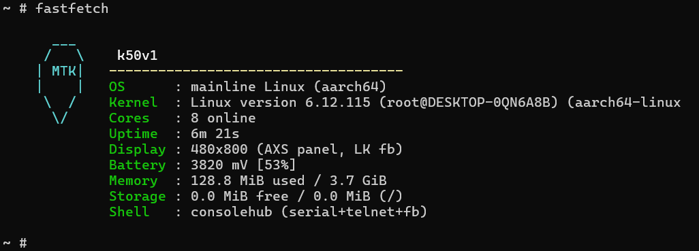
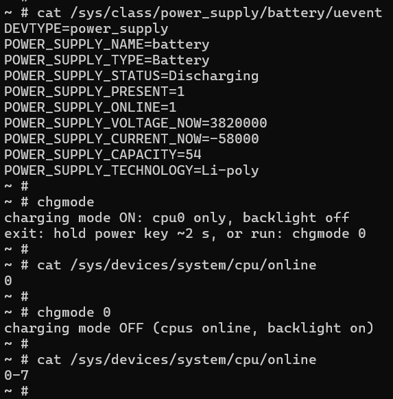

# 常用命令速查（k50v1 mainline bring-up）

> 适用：r101 及以后镜像。串口（CH340 921600 8N1）、telnet（192.168.137.x）或
> 屏幕 framebuffer 控制台均可执行。截图见文末。

## 系统信息

```sh
fastfetch
```

一屏显示：内核版本、在线核心数、运行时间、显示分辨率、电池（电压/百分比/充电状态）、
内存、存储、shell。

## 电量查询

```sh
cat /sys/class/power_supply/battery/uevent       # 一次看全部
cat /sys/class/power_supply/battery/capacity     # 电量百分比（3.4~4.2V 电压估算）
cat /sys/class/power_supply/battery/voltage_now  # 电压，微伏（3820000 = 3.82V）
cat /sys/class/power_supply/battery/current_now  # 电流，微安（正=充电，负=放电）
cat /sys/class/power_supply/battery/status       # Charging / Discharging
```

说明：

- 没有电量计芯片，百分比是**电压线性估算**（3.4V=0% ~ 4.2V=100%），中段有偏差；
- 电压值本身是准的（MT6353 AUXADC ch0 BATSNS，`raw*3*1800/32768`）；
- `current_now` 用 ISENSE−BATSNS 除以 68mΩ 采样电阻，插上 USB 后应看到正数。

## CPU 查询

```sh
cat /sys/devices/system/cpu/online               # 在线的核（"0-7"；充电模式时是 "0"）
cat /sys/devices/system/cpu/offline              # 已下线的核
grep processor /proc/cpuinfo                     # 在线核列表
cat /proc/stat | grep ^cpu                       # 每核运行时间（做差算负载）
```

## 充电模式

```sh
chgmode          # 进入：下线 CPU1-7 + 关背光，充电/喂狗照常
chgmode 0        # 退出：恢复 8 核 + 开背光（亮度 190）
```

退出也可以**长按电源键约 2 秒**（内核 300ms 轮询 PMIC 的 `PWRKEY_DEB` 位，
状态相对基线翻转保持约 1.8s 即退出）。sysfs 入口：
`/sys/kernel/mt6353/chgmode`、`/sys/kernel/mt6353/pwrkey`。

音量键组合（音量上2下3）暂不可用：音量键走 MTK kpd 矩阵键盘控制器
（DT `kpd-hw-init-map = <0x73 0x72 ...>`），主线缺该驱动，移植后再加。

## 关机 / 重启

内核检测到 **PSCI v0.2**，关机经 ATF→PMIC 真正断电：

```sh
poweroff -f      # 真关机（psci_system_off）
reboot -f        # 重启
```

要带 `-f`（init 不是完整 init 系统，不带 `-f` 只发信号不生效）。

## 已知小瑕疵

- `fastfetch` 的 Storage 一栏在 initramfs（ramfs）上显示 0.0 MiB——ramfs 无容量
  统计，属显示问题；真实容量可 `statvfs /data` 或后续把 userdata 挂进统计。

## 实拍




